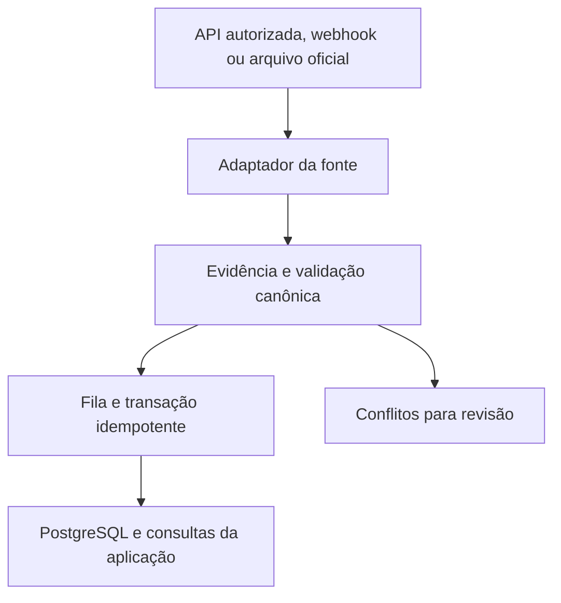

# V4 — Camada única de integração oficial

Substitui a etapa de descoberta por scraping do [plano V4](2026-10-21-import-engine-v4-rebuild-plan.md) para as fontes que entregarem dados estruturados autorizados. Preserva a fila durável, a transação de escrita, o histórico PostgreSQL/Supabase e os contratos de leitura usados pelas telas atuais.

## Contrato e dados

`OfficialProviderAdapter` declara capacidades e versão. A configuração registra fornecedor, entidade emissora, forma de acesso, escopos, política de retenção, versões aceitas e limites. Cada método recebe escopo autorizado, chave externa e cursor quando aplicável. `listMeets` enumera competições, `getEntries` entrega inscrições, `getStartlists` entrega balizamento, `getResults` entrega marcas/status/parciais, `getUpdates` entrega mudanças se o provedor oferecer o contrato e `getEvidence` acompanha todo dado ingerido. Capacidades ausentes não podem ser anunciadas. O [protótipo](../../prototypes/official-provider-contract/README.md) valida essa regra.

| Entidade canônica v1 | Chave e conteúdo mínimo |
|---|---|
| Identidade | Conta + atleta local + provedor + entidade/namespace + registro oficial. Um ID local ao arquivo exige mapeamento verificado. Nome e clube só auxiliam a triagem. Identidade ambígua bloqueia escrita. |
| Competição, sessão e prova | ID oficial e namespace. No LENEX, IDs locais à competição precisam ser combinados com a chave externa da competição, sessão, número de prova, rodada, sexo e piscina quando aplicável. Metadados ausentes e sem correspondência comprovada ficam em revisão. |
| Inscrição/balizamento | Chave de participação oficial por prova/rodada. Seed, horário, série e raia separados do resultado. Raia zero é valor válido quando publicada. Guardar histórico de nova alocação. |
| Resultado | Chave da participação ou ID oficial da marca por prova/rodada, sem incluir tempo. Separar tempo em ms, status, homologação, colocação e parciais por distância. DNS/DNF/DSQ sem inventar tempo oficial. Tratar revezamentos explicitamente, sem promover parcial a resultado individual. |
| Publicação | Provedor, evento, tipo, revisão, estado completo/parcial, URL ou identificador de entrega, timestamp UTC, SHA-256 dos bytes, versão do esquema e adaptador. Artefato bruto protegido apenas conforme autorização, fora do Git e sem segredos. |

## Sincronização e escrita

1. Para API licenciada, autenticação dedicada no servidor com privilégio mínimo. Webhook assinado e proteção contra replay apenas com protocolo do fornecedor. Preferir evento de revisão como gatilho para reler a publicação oficial. Na ausência, usar cursor, ETag ou Last-Modified somente se o provedor suportar. Checkpoint avança após persistência ou enfileiramento durável. LENEX começa com recepção explícita por competição, com limite de tamanho e de expansão do ZIP, validação de versão e XML sem DTD/entidades externas. Um arquivo parcial jamais invalida registros ausentes.
2. Fila única com lease, fencing e chave por conta/competição/operação/revisão. Validação de autorização e vínculo do atleta dentro da transação. SQL escreve evidência, inscrições e resultados atomicamente, atualiza derivados de acordo com a revisão e grava recibo idempotente. Resposta incerta consulta recibo antes de repetir. Provas de outras contas e dados manuais passam pelos contratos de RLS existentes e por testes de regressão. Dados oficiais compartilhados só em repositório privado, se licenciados, com projeção por conta.
3. Mesmo hash repetido não cria linhas. Revisão mais nova e autenticada altera a projeção e mantém trilha da anterior. Uma publicação provisória tardia não substitui a homologada. Conflito sem ordem confiável fica em quarentena. Anulação exige sinal oficial explícito. PBs recalculam quando uma revisão invalida ou altera a marca, preservando origem e piscina.
4. Falhas trazem código, causa, retryable, URL sem segredo, tentativa e escopo. Backoff com jitter e Retry-After para 429, timeout ou 5xx. 401/403, schema desconhecido ou vínculo ambíguo bloqueiam até correção. Erro SQL preserva mensagem e SQLSTATE. Medir separadamente vazio legítimo, documento incompleto e falha. Reinício retoma lease vencido sem dupla escrita.
5. A troca usa shadow local e, depois de autorização operacional, shadow isolado. Comparar contagens e campos com publicação oficial, validar regressão visual e congelar o baseline dos leitores. O corte altera o escritor por escopo com uma configuração reversível. O rollback pausa novas ingestões, reconcilia recibos, mantém histórico e reativa no máximo um escritor autorizado e compatível.

## Custo e prova

A página pública amostrada tem dez documentos. O caminho antigo pode exigir catálogo, página do evento e leitura de vários PDFs. Um LENEX autorizado por publicação poderia reduzir o processamento a um arquivo por fase, mas o número de arquivos, cobertura e tamanho reais ainda são desconhecidos. O JSON do Masters Paraná medido tem 518.145 bytes e carrega HTML de páginas. O tempo HTTP registrado é do ambiente de investigação, não latência de produção e nem benchmark do novo caminho.

No piloto, pedir balizamento pré-prova, resultado homologado e retificação do mesmo evento. Usar atleta autorizado escolhido para esse ensaio e comparar prova/rodada/piscina/raia/tempo/status/parciais com as publicações oficiais. Importar duas vezes em banco descartável, verificar segunda execução com zero novas linhas, aplicar retificação e testar replay fora de ordem, autorização revogada, arquivo inválido e reinício. Registrar chamadas, bytes, tempo, CPU, pico de memória e divergências de cada caminho. Sem arquivo real autorizado ou API contratada, esse benchmark e o aceite de ingestão permanecem pendentes.
