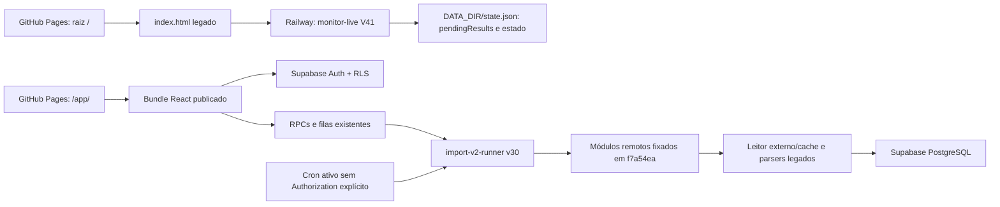
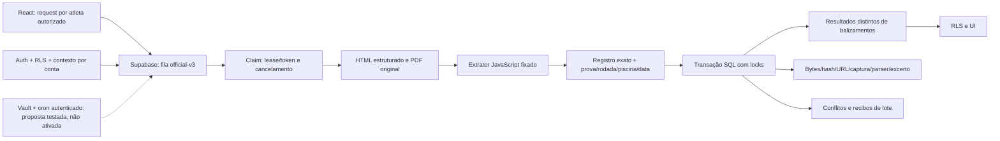

# Correções após a revisão independente — 11/10/2026

**Status: REPROVADO. PR #17 permanece draft. Nenhum merge ou deploy nesta etapa.**

Esta execução leu `independent-review-and-codex-actions.md`, commit `28212ec`, diretamente no GitHub. As propostas novas de SQL e a Edge `official-import-runner` **não foram aplicadas/publicadas**. As três migrations de segurança anteriores, confirmadas pela revisão, não foram reaplicadas. Não houve limpeza adicional, fusão de atletas, escrita manual de resultados ou restauração de backups em produção.

## Mapa publicado, confirmado por bytes e infraestrutura

A consulta pública [38156915485](https://github.com/henriqueballao/VINISWIM/actions/runs/38156915485) confirmou DNS A `185.199.108/109/110/111.153`, resposta `Server: GitHub.com` e igualdade dos blobs servidos com `main`:

- `/`: `index.html`, blob `39077c531db914ed81b1c3a0eb0295214a847d68`, SHA-256 `20141d0240b3bdb5d86333aa96ca92d8d19fc825bef1b185ffd555b24b9e4f4a`.
- `/app/`: `app/index.html`, blob `c54ebabee34783e6a3846eeecd37b7136f74fe72`, SHA-256 `c222f04674b975346b072b68cf6bd4387d21b6424493ceb21f4b12e65f04538a`.
- O HTML do React identifica `index-BjbdadaH.js?v20261009-1`; essa identificação é uma captura datada, não uma suposição sobre deploys futuros.
- O workflow `viniswim-commercial-app.yml` compila `commercial/apps/web` e grava os artefatos em `app/` de `main`. As correções desta branch ainda não aparecem nesses bytes publicados.

### Correção da conclusão sobre Railway

Há um **caminho legado de escrita local**: o servidor V41 publicado, fonte do commit `9fc7d53`, lê/grava `state.json`, incluindo `pendingResults`; a raiz do domínio ainda chama `/pending-results`, `/sync-results` e `/refresh-athlete` nesse serviço. O serviço live não tem volume montado; o serviço antigo tem volume `/data`. Isso não comprova o conteúdo efetivo do disco nem torna Railway o banco autoritativo do React. O bundle `/app/` não contém essas referências.

`STATE_API_URL` existe como nome de variável, mas **não é referenciada pelo arquivo V41 publicado**. A inferência anterior de que essa variável demonstrava persistência externa não se sustenta para esse executável. Seu valor secreto não foi copiado. Não removemos serviços/volumes nem a raiz ativa, pois há consumidores comprovados.

## Causas e correções verificáveis

| Causa | Correção na branch | Evidência e limite |
|---|---|---|
| Chave sem tenant, número de prova, rodada e sexo | `current-meet-adapter.mjs`; identidade completa, sem tempo/status | Testes de colisão e unicidade SQL; ainda não implantado |
| Hash/horário apenas declarados pelo chamador | `official-document.mjs`: captura direta dos bytes, hash calculado e atestação privada por WeakMap; SQL recalcula hash dos bytes | Objetos copiados/JSON e bytes adulterados são rejeitados |
| Datas/piscina/documento de outra competição | Parsers e adaptador ligam prova, cabeçalho, datas, piscina e caminho oficial; SQL liga também cursor do job à competição | Testes negativos e rollback de lote |
| `retryState` ocultava erros bloqueantes | Máquina de estados preserva código/erro e limita backoff; proposta `official-worker-outcomes.sql` persiste resultados | 401/403/anti-bot bloqueiam; 404/timeout têm retentativas limitadas |
| Trigger publicado podia converter `blocked` em solicitação concluída | Definição real capturada em `published-triggers.sql`; reprodução antes da proposta `official-finalization-trigger.sql` | Falha real adicional, não resolvida em produção |
| Raia zero rejeitada pelo banco | Proposta `official-event-integrity.sql` aceita raia 0, distingue corridas oficiais e mantém índices legados separados | Lorenzo tem raia 0 na publicação; teste SQL reproduz restrição antiga |
| Concorrência/cancelamento/resposta de commit perdida | Leases com token/expiração, fencing do claim legado, locks transacionais, recibo com hash do lote, cancelamento com lock de request primeiro | Sessões PostgreSQL concorrentes e recibo repetido testados |
| Revisões oficiais sobrescritas ou duplicadas | Chave estável; contradições entram em `official_import_conflicts`, preservando evidência e valor anterior | Reconciliação posterior ainda necessária; não escolhemos revisão arbitrariamente |
| Cache de PB concorrente | Trigger real de PB reproduzido; proposta usa lock por atleta/prova/piscina; lotes ordenados por prova | Não equivale a validação de todo o esquema de produção |
| UI associava resultado por meet/prova genérica | `result-for-entry.ts` exige atleta, fonte, piscina e descritores oficiais; ambiguidade é exibida | Tests/build e smoke com mocks; UI publicada ainda antiga |
| Botão acionava fila desconectada | UI candidata chama `request_official_meet_import`, com autorização por atleta e request/job auditáveis | RPC é proposta; não publicar essa UI isoladamente |
| Build sem lock | `commercial/package-lock.json`, pins npm, `npm ci`, Deno lock e verificação frozen; browser tests instalam Playwright fora do grafo do build | Build candidato; nenhum deploy automático desta branch |
| Fixtures dependiam de artifacts temporários | Dois ZIPs originais em `fixtures/official-originals`, manifestos e verificação de SHA-256 antes da extração | Arquivos de teste; nunca enviados à produção como restauração |

O worker candidato `official-worker/src/runner.mjs` exige autenticação de serviço antes do claim, obtém contexto por RPC autorizado, consulta publicações originais, valida o lote e chama a transação. Revalida contexto antes de cada documento e propaga falhas de registro de erro. A Edge candidata usa SDK fixado e extrator JavaScript local; não envia documentos a um leitor externo e não contorna login/CAPTCHA/Turnstile.

## Publicações originais: três atletas localizados

A consulta pública [38161104219](https://github.com/henriqueballao/VINISWIM/actions/runs/38161104219), às 17:48 UTC, recuperou documentos novos desde a captura das 14:39. A segunda etapa de outubro passou a estar publicada. Os originais são preservados, sem alteração, no ZIP `20261011-1748.zip`, SHA-256 `5d359b9f4b954aa178484f22208f2f5d9bd4246906fa4c7976bf2f30da99bb45`. O manifesto interno registra URL, captura e hash de cada arquivo.

| Registro | Outubro: balizamentos / resultados | Competição histórica: balizamentos / resultados |
|---|---:|---:|
| Vini 422692 | 4 / 4 | 5 / 5, incluindo DNS em 50 Livre |
| Lorenzo 399680 | 5 / 5 | 6 / 6 |
| André 393259 | 0 / 0: identidade não localizada nos documentos consultados | 6 / 6 |

A competição histórica é `9b002997-591e-4f74-8492-ef595b4705c0`, Campeonato Paranaense de Verão (Mirim/Petiz), já indicada na configuração existente. Sua recuperação não prova histórico esportivo completo. Não foi inferida participação de André no regional de outubro.

Os quatro balizamentos de Vini mantêm os horários/séries/raias recuperados da publicação. Tempos de inscrição permanecem em `meet_entries`; resultados nadados permanecem separados. Nenhum valor de referência do proprietário foi inserido para simular funcionamento.

## Quatro camadas de validação

1. **Parser/fixture**: parsers e contratos com testes positivos e negativos, origem original preservada e excertos reconstituídos dos oito PDFs iniciais.
2. **Consulta pública ao vivo**: página estruturada e links oficiais descobertos por DOM (`parse5`), downloads diretos e captura de bytes das duas competições. A consulta não chamou Supabase.
3. **Persistência real em PostgreSQL isolado**: [38164871972](https://github.com/henriqueballao/VINISWIM/actions/runs/38164871972), com DDL candidata, triggers publicados, autorização, worker/contexto/captura e transação. Extratores JavaScript e Poppler concordaram nos resultados; dados SQL foram comparados às publicações. Segunda ingestão: `inserted=0`, duplicados 6/5/6/4/5 nos cinco pares atleta/competição; nenhum balizamento atualizado indevidamente. Isso inclui 9 registros de Vini, 11 de Lorenzo e 6 de André nesse banco **descartável**. Recibos, concorrência, cancelamento e negação entre tenants também passaram.
4. **E2E autenticado da UI publicada e produção**: não realizado. Smoke de CI usa dados sintéticos e respostas mockadas; não é evidência desta camada.

Teste Deno [38161892187](https://github.com/henriqueballao/VINISWIM/actions/runs/38161892187) passou em Deno 2.1.4 com os PDFs originais; o CI frozen posterior identificou uma resolução automática de tipos Node ausente do lock, corrigida sem remover `--frozen`. A execução frozen [38165004790](https://github.com/henriqueballao/VINISWIM/actions/runs/38165004790) passou após a correção. Limites reais de CPU/memória da Edge ainda precisam de validação em ambiente adequado; performance no runner Actions não comprova performance Supabase.

Em consulta somente de leitura às **17:56:51 UTC**, produção permaneceu com `results=0`, `meet_entries=0`, `personal_bests=0`. Não extrapolamos isso às demais tabelas derivadas. A consulta de cron confirmou runner v2/minuto e enqueuers legados ativos; nenhum Authorization explícito nesses agendamentos. Vault contém apenas nomes VAPID, sem token configurado para o novo worker. A autenticação e o cron novos ainda exigem uma implantação coordenada e validada; não alterar um deles sozinho.

## Arquitetura candidata e pendências efetivas

Esta é uma candidata testada em partes, **não uma consolidação publicada**. Ainda faltam: ativação validada do agendamento/monitor autenticado e prova de detecção automática em infraestrutura final; implantação e verificação dos fences no cutover; análise completa das dependências/schema/roles; procedimento coordenado de migração/Edge/UI; adaptadores autorizados para demais fontes; descoberta histórica ampla; reconciliação de revisões; E2E real publicado; reinício/redeploy e prova de recuperação. Atletas de contas diferentes continuam separados; configuração de André não foi inventada nem fundida por nome.

## Validações adicionais após o relatório inicial

- Monitoramento por competição autorizada, deduplicação de jobs pendentes, revogação de associação, próxima consulta e backoff foram implementados como propostas SQL. Vault fornece token de serviço e o despacho HTTP exige Authorization antes de enfileirar. [38165613559](https://github.com/henriqueballao/VINISWIM/actions/runs/38165613559) passou em banco isolado. Vault/net são stubs nesse teste: não comprovam requisição autenticada na infraestrutura final. Nenhum token foi provisionado ou cron ativado em produção.
- Fence de INSERT/UPDATE/DELETE oficial impede escritores legados de modificar atletas inscritos no pipeline candidato, preservando outros tenants. [38165782378](https://github.com/henriqueballao/VINISWIM/actions/runs/38165782378) passou isoladamente. Não houve desativação global dos workers antigos e o fence não foi aplicado no banco ativo.
- A fixture SQL agora espelha as 12 tabelas centrais consultadas, com 153 colunas, 57 constraints, índices, enums e 17 policies reais. [38166194629](https://github.com/henriqueballao/VINISWIM/actions/runs/38166194629) passou com essa estrutura. Auth, contas e outras dependências usam stubs mínimos: isto não constitui clone completo do Supabase. A recuperação de leases passou a bloquear request antes de job, mantendo a ordem de cancelamento/commit.
- A view publicada não expunha os descritores oficiais de corrida. `official-result-timeline.sql` conserva as 20 colunas existentes e acrescenta os quatro descritores, com security_invoker. [38166665908](https://github.com/henriqueballao/VINISWIM/actions/runs/38166665908) verifica separação por tenant, leitura da view, CRUD manual permitido e UPDATE/DELETE oficial negado sob role authenticated e policies reais. Proposta não aplicada.
- A UI candidata descarta respostas atrasadas de outra conta/atleta, limita polling simultâneo, verifica erros retornados pelo SDK e consulta procedência dos resultados atuais. Ações de edição/exclusão exigem resultado manual e papel autorizado; escrita com zero linhas afetadas não vira sucesso.
- Melhores marcas confirmadas filtradas excluem resultados manuais e agrupam prova/piscina. O gráfico de todas as provas também separa piscinas; antes ligava tempos de 25 m e 50 m numa série. Teste de domínio passou localmente. Build e navegador desktop/celular [38167400541](https://github.com/henriqueballao/VINISWIM/actions/runs/38167400541) passaram no commit `703f076`. O teste anterior falhou por ausência da tabela meets na fixture; a consulta foi modelada, mantendo as assertions. São testes sintéticos de preview, não E2E publicado.
- Commit `0e763b9` acrescenta tratamento explícito de falha de leitura de contas e teste de indisponibilidade/recuperação no navegador. [38167462968](https://github.com/henriqueballao/VINISWIM/actions/runs/38167462968) passou em desktop/celular, incluindo ausência de botão de exclusão oficial. Import V2 [38167462963](https://github.com/henriqueballao/VINISWIM/actions/runs/38167462963) também passou.

As propostas ficam em `commercial/supabase/proposals`, sem integração no fluxo automático de migrations: ainda exigem validação coordenada das dependências e da ativação. Não houve merge nem deploy das correções desta etapa.

## Gates da revisão independente

| Gate | Status | Evidência que ainda falta |
|---|---|---|
| 1 Pipeline completo/domínio | REPROVADO | Mapa legado confirmado; cadeia corrigida ainda não publicada |
| 2 Código morto isolado | REPROVADO | Raiz/Railway são consumidores ativos; cutover e isolamento operacional pendentes |
| 3 Importação oficial persistida sem escrita manual | REPROVADO | Pipeline passou apenas em PostgreSQL isolado |
| 4 Três atletas | REPROVADO | Publicações e testes dos três existem; produção permanece vazia |
| 5 Persistência versus originais | REPROVADO | Comparação isolada passou; comparação em produção pendente |
| 6 Balizamentos completos no banco | REPROVADO | Originais/teste isolado corretos; Supabase ativo vazio |
| 7 Procedência persistida | REPROVADO | Bytes/evidência na candidata isolada; schema ativo ainda não migrado |
| 8 Segunda ingestão idempotente | REPROVADO | Idempotência SQL isolada comprovada; segunda ingestão no Supabase ativo pendente |
| 9 UI publicada = banco | REPROVADO | Bundle publicado anterior e E2E real não executado |
| 10 Monitor reconhece nova publicação | REPROVADO | Nova publicação recuperada por consulta ao vivo; agendamento candidato não operacional |
| 11 Falhas não ocultadas pelos workers publicados | REPROVADO | Correções e testes em branch; v115/v30 e finalizador ativo continuam anteriores |
| 12 Restart/redeploy mantém operação | REPROVADO | Nenhum deploy/restart da cadeia corrigida realizado |

Não promover CI, commit, fixture ou consulta pública à condição de homologação do produto publicado. Os resultados acima são avanços verificáveis; não alteram a reprovação operacional.
