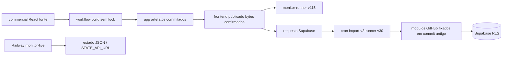
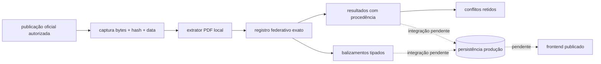

# Auditoria VINISWIM — 11/10/2026

**Resultado global: REPROVADO. Missão incompleta.** Este relatório distingue alterações implementadas, alterações publicadas e validações documentais. Nenhuma escrita manual de resultado ou balizamento foi realizada. Nenhum dado esportivo foi excluído ou restaurado.

## Execução comprovada

O HTML de https://viniswim.com.br/app/ carrega `assets/index-BjbdadaH.js?v=20261009-1`. HTML e bundle capturados correspondem aos blobs da branch main: HTML `c54ebabee34783e6a3846eeecd37b7136f74fe72`, JS `c1e33fa3d3694116a3fa3b792d4a0dcf545e7c6c`. SHA-256 e comparação estão nos arquivos adjacentes. A coincidência de bytes comprova o artefato servido; não comprova qual serviço originou sua publicação.

A workflow `viniswim-commercial-app.yml` instala dependências sem lockfile, compila os workspaces commercial e grava dist em app por commit na main. O App.tsx e o bundle publicado divergem: a ação importOfficial do bundle chama monitor-runner, enquanto o fonte cria source_link_requests. Reconstruir e publicar sem reconciliar essa diferença pode retirar comportamento em produção. Não editamos o bundle minificado.

Supabase VINISWIM `cdtvhagbgiwnjkgninqn`, sa-east-1, PostgreSQL 17.6: monitor-runner v115 e import-v2-runner v30. Este último importa módulos GitHub fixados em `f7a54ea2298888aa40fa072758b8105ec5388fda`; modificar os módulos na nova branch não modifica a função publicada. Cron v2 por minuto; varreduras a cada seis horas e diariamente; nenhum cron denominado monitor-runner na lista consultada. O banco contém 46 relações públicas, incluindo caches e tabelas administrativas além da lista inicial.

Railway: VINISWIM-COMMERCIAL tem web e monitor com últimos deploys FAILED. O projeto VINISWIM-MONITOR tem monitor-live SUCCESS, commit `9fc7d53da38897104895b29124acb18181aeff7a`, do repositório principal, root `/railway-monitor`. O serviço vinculado ao repositório secundário não apresenta último deploy. Monitor-live usa estado JSON/STATE_API_URL; não foi comprovado seu caminho até results. `railway-monitor` não pode ser removido como código morto. Nenhum serviço Railway foi alterado.

## Causas-raiz confirmadas

* processCurrent v2 importa startlists, sem persistir resultados nadados. Seu parser retorna heat/lane nulos e não extrai scheduled_at.
* Captura textual por leitor externo e caches não demonstra captura original; raw_hash nulo em result_sources.
* Fingerprint com tempo/status permite duplicar uma correção oficial.
* catch vazio na leitura de documentos e erros retornados pelo banco ignorados ocultam falhas.
* As duas funções publicadas têm verify_jwt falso e seus handlers não validam autorização do chamador. RPCs de solicitação verificam associação, mas isso não protege os próprios handlers. Correção ainda pendente.
* Cancelamento pode ocorrer após escritas; não foi comprovada recuperação segura de todos os jobs interrompidos.
* 12 execuções recentes do monitor estavam completed, found=0, inserted=0, sem error_code. Havia oito monitor_jobs pendentes. Totais antigos de v2 não comprovam funcionamento atual.
* Múltiplos fluxos, código-fonte/bundle divergentes e módulo pinado explicam mudanças sem efeito. Não removemos componentes sem provar inutilização.

## Identidade e limpeza

Na conta `8213ebbb-2d8a-421c-87e0-6911fc9c096c`: Vini `f02e62f2-4987-4c99-aa21-1b8d89b80e65` / 422692; Lorenzo `29ccbda0-fd1b-4fba-a39b-3486f78588c4` / 399680; André `4949f776-8a46-4abe-9339-7d86192c82ca` / external_id 393259 em athlete_source_configs, sem athlete_identifiers. Os outros perfis de Vini e Lorenzo pertencem a contas diferentes: `af41d466-479b-47e5-8ffb-6dd03ae26e4f` e `32ff6a40-b7a3-4cf9-9739-35b6138993f9`. Não são candidatos a fusão global por nome.

Results, meet_entries e personal_bests estavam zerados nos cinco perfis na consulta inicial e na verificação posterior. Outras tabelas derivadas não foram integralmente auditadas para limpeza. Identificadores, responsáveis, autenticação e configurações foram preservados. Importadores antigos continuam ativos; portanto o requisito de impedir repopulação sem rastreabilidade está pendente.

## Mudanças realizadas

Branch `fix/official-import-audit-20261011`, PR draft #17. Adaptador documental com allowlist HTTPS, validação de redirecionamentos, limites, timeout, hash de bytes, captura e classificação explícita de 401/403/anti-bot/404. Sem CAPTCHA, sessão fabricada ou proxy de leitura. Parser de balizamento preserva inscrição, série, raia inclusive zero e horário em America/Sao_Paulo. Resultados e balizamentos são entidades distintas. Chave de resultado exclui tempo para permitir reconciliação; publicações contraditórias são retidas. Associação por registro exato evita prefixos; datas e piscina inconsistentes são rejeitadas. Backoff e estados de falha têm testes.

O adaptador é implementado e testado, **mas não conectado ao worker de produção nem à persistência**. Não há prova de idempotência no banco ou de operação automática. Alterações React corrigem nomenclatura de tempo de inscrição e exibem horário; ficaram na branch, sem deploy.

Três migrações de segurança aplicadas e versionadas: view timeline security_invoker; exclusão pelo navegador apenas de resultados manuais; revogação de escrita e RLS default-deny em cinco caches internos. service_role mantém acesso. Assertions SQL passaram. Simulação read-only com dois usuários reais retornou três e um atletas de suas próprias contas, zero atletas externos e zero caches visíveis. Sem dados sintéticos na produção. Com results vazio, isso não comprova segregação de resultados populados. Advisors após correções: nenhum ERROR; permanecem avisos de funções SECURITY DEFINER expostas e proteção contra senhas vazadas desativada, além de INFO para tabelas RLS sem policies destinadas ao worker.

## Evidência documental e testes

Captura autorizada por GitHub Actions em https://github.com/henriqueballao/VINISWIM/actions/runs/38148027929. Os oito PDFs públicos ligados à competição retornaram HTTP 200; a indisponibilidade anterior de Resultados 1ª Etapa não ocorreu nessa captura. Proveniência e trechos oficiais: `commercial/packages/import-v2/fixtures/official-20261011/provenance.json`. Originais preservados no artifact da workflow, sujeito ao prazo de retenção de 14 dias, e na cópia local de auditoria.

Documentos confirmam Vini: 100 Costas 10/10 16:59 série1 raia5; 50 Livre 10/10 17:50 série1 raia5; 50 Costas 11/10 09:38 série2 raia8; 100 Livre 11/10 11:26 série1 raia5. Resultado de primeira etapa: 100 Costas 1:43.91 e 50 Livre 43.78. Lorenzo: cinco balizamentos, incluindo raia zero; resultados 100 Borboleta 1:42.71 e 50 Livre 33.38. André 393259 não aparece nos oito PDFs examinados. Essa ausência não prova ausência histórica; exige descoberta autorizada de outras competições.

Esses valores foram lidos e testados; **não inseridos no banco**. Fixtures exercitam parser e não equivalem a importação ao vivo concluída.

Suíte local completa: 20 arquivos de testes passaram. CI Import V2 Gates: https://github.com/henriqueballao/VINISWIM/actions/runs/38148912436. UI Gate2: https://github.com/henriqueballao/VINISWIM/actions/runs/38148912422 — typecheck, build React e smoke Playwright passaram. Smoke autenticado usa mock; não comprova aplicativo publicado autenticado. Checker de bundle mantém 18 assertions e reconhece URL com ?v=. Nenhum deploy frontend/Edge realizado. Shell local não consegue usar o proxy configurado; conectores e Actions permitiram auditoria e build sem contornar proteção.

## Gates de aceitação

| Gate | Estado | Evidência / pendência |
|---|---|---|
| Pipeline produção identificado e documentado | REPROVADO parcial | frontend e workers confirmados; infraestrutura que serve domínio e ponte Railway não comprovadas |
| Código morto removido ou isolado | REPROVADO | não houve remoção sem prova; legado documentado |
| Importações reais sem escrita manual | REPROVADO | leitura documental real; persistência não integrada |
| Três atletas importados oficialmente | REPROVADO | Vini/Lorenzo identificados documentalmente; André ausente nessa competição |
| Comparação com publicações originais | REPROVADO parcial | parser comparado a PDFs; dados importados no banco inexistentes |
| Balizamentos completos corretos | REPROVADO parcial | quatro Vini e cinco Lorenzo comprovados no parser; banco vazio |
| Banco registra fonte/captura/evidência | REPROVADO | contrato pronto; produção não conectada |
| Segunda importação idempotente | REPROVADO | determinismo do parser testado; idempotência de persistência não demonstrada |
| UI publicada igual ao banco | REPROVADO | bytes publicados confirmados; E2E real autenticado não executado |
| Monitor reconhece novas publicações | REPROVADO | pipeline novo não ligado ao monitor |
| Bloqueios não ocultados | REPROVADO parcial | helper novo distingue; workers antigos ainda silenciam |
| Reinício e novo deploy preservam operação | REPROVADO | não houve deploy/reinício da solução consolidada |

Testes históricos, DNS/DSQ e retentativas existentes passam no ambiente de teste, mas não substituem execução oficial ao vivo dos três atletas. Persistência transacional, reconciliação, identidade tenant-aware, cancelamento, recuperação de leases, autorização dos handlers, integração frontend/worker, lockfile e deploy reproduzível permanecem trabalho necessário. O PR está em draft precisamente porque esses requisitos não foram concluídos.
