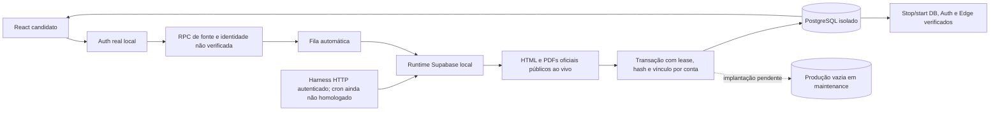

# VINISWIM — runtime Supabase, cadastro pela UI e recuperação
Data: 2026-10-12. Branch: fix/official-import-audit-20261011. PR #17 draft.
**Situação do aplicativo publicado: REPROVADO. Não foi entregue resolvido.**

## Escopo atualizado pelo proprietário
Vini, Lorenzo e André foram retirados como casos de aceitação. Não executar novas importações desses perfis para homologação. O requisito de validar aqueles três deixa de ser bloqueio: o teste final será com um atleta escolhido pelo proprietário sem aviso prévio, associado por registro/fonte e importado pelo aplicativo sem escrita manual. Fixtures/documentos antigos permanecem evidência histórica e regressão de parser, não dados para restaurar na produção.

O registro 437084 usado aqui é um caso adicional de teste selecionado de uma publicação pública. Não é o atleta surpresa do proprietário, nem comprovação de seu teste futuro.

## Correções desta execução
- 47d028150eef490134b3b5e71b018ce5ba840244: chama a entrada Deno real por HTTP, em vez de importar o handler Node diretamente.
- 4ff6ee7185fb77501ff190f8f669955b93cebbf2: lê token do Vault a cada requisição quando não há segredo de ambiente. Corrige aceitação de token revogado em isolate quente; falha de inicialização ganha log estruturado sem segredo.
- 1c02f9163bb730b4f0c2474cdffc05284db71d5f: empacota os módulos com manifesto SHA256 e executa via supabase functions serve, runtime local do Supabase. Somente caminhos relativos da entrada são realocados; módulos permanecem iguais.
- 8987cf2b71decd3a73b790a618b7c6b57ac9bec0: cadastro da fonte pela interface real, sem configurar a fonte pelo script.
- 905de19b60607429faa2173273b6267d26ebb17d: compara cada data, prova, piscina, tempo e competição com o banco, na tabela e no cartão móvel.
- 66cc4ec0a97cdcec22966469cda81c0b0d1431b3: corrige confirmação perdida ao salvar fonte. A atualização chamava loadIdentity, desmontando SettingsPage; fontes agora atualizam somente dados do atleta. Atualização de perfil mantém recarga de identidade.
- 4e059c8b6689b1a81d0c92c52485df3fb65f68fc: reinicia também o worker Edge e verifica autenticação com segredo recuperado do Vault, além da conservação dos dados.

As execuções 38248730056 e 38249129902 falharam esperando a confirmação do cadastro. A asserção foi mantida; a correção 66cc4ec fez a sequência passar. Não classificar aquelas falhas como sucesso.

## Evidência operacional isolada atual
Código até 4e059c8. Execução https://github.com/henriqueballao/VINISWIM/actions/runs/38250000935, job 114813522187: success. UI/build 38250006414 e Import V2 Gates 38250006551: success.

Artifact 11747183040: SHA256 ZIP 4b3b2af23c76dff84769653a41cdcc912ec45026cbd62d3777fe991b280b55dd. JSON operacional, manifesto de captura e manifesto do pacote são preservados em edge-browser-recovery-evidence, sem depender da retenção do artifact.

A execução confirmou oito sinais:
1. entrada Deno real;
2. runtime Supabase CLI;
3. cadastro da fonte por navegador autenticado;
4. rotação de Vault no worker quente;
5. reinício efetivo dos serviços;
6. resultados e procedência conservados integralmente;
7. função reiniciada e autenticação recuperada;
8. negação de leitura cruzada entre duas contas.

O navegador iniciou fila ao salvar registro e fonte, sem clicar em busca. O identificador não foi autoverificado antes da leitura oficial. A função buscou HTML/PDFs públicos ao vivo e persistiu cinco resultados e cinco entradas. Segunda ingestão: zero inserções e cinco duplicados reconhecidos em cada entidade. Conta B não leu A; navegador não leu segredo nem invocou persistência privilegiada. UI comparou valores, não apenas contador. Após stop/start, nova autenticação e leitura conservaram linhas, URLs, hashes e horários; a função voltou, negou chamada sem token e respondeu idle à chamada autenticada.

### Limites que continuam reais
- Ambiente local descartável no runner, não o projeto de produção nem o domínio publicado. Auth/REST/Edge/PG são reais, mas tabelas periféricas de conta/perfil são fixtures limitadas.
- O harness chama HTTP no lugar do cron, prioriza a competição c8587533-2e44-4b08-991f-f827170c7344 e cancela outros filhos. A fila é criada automaticamente pela UI, mas esta execução não comprova operação contínua do agendamento, ingestão das 70 competições ou histórico completo.
- Limites operacionais do Edge hospedado não foram medidos.
- Fontes sem adaptador e formatos históricos não suportados continuam impedimentos funcionais. A leitura de uma competição não representa toda a carreira.
- Catálogo amplo pode produzir identidade não localizada em competições sem participação; a finalização atual conta blocked como falha. Isso exige avaliar apresentação e cobertura antes de declarar busca histórica concluída.
- Revogação de RPCs antigos, schema completo candidato, worker, segredo e cron novos não foram instalados/ativados em produção nesta execução.
- Não houve merge, deploy, remoção de holds, restauração ou escrita de resultados esportivos em produção.

## Originais e procedência
Os quatro PDFs desta execução foram recalculados por SHA256. Os hashes são iguais aos quatro arquivos preservados em native-live-evidence no commit 1897b23. O novo manifesto registra os horários efetivamente capturados nesta execução. Documento final de resultados: bf21a054397316983464ac7b6b0f6bc393a4b805270e82a2154415d387f4c510.

Para reconstruir PDF: base64.decode + gzip.decompress dos arquivos native-live-evidence/*.pdf.gz.b64; comparar hash e tamanho com o novo manifesto. O JSON atual contém as linhas e result_sources efetivamente persistidos no banco local. productionWrites=0. Não houve INSERT/UPDATE manual de resultado para aprovar a prova. Usuários/perfis/metadados de teste foram criados somente no ambiente isolado.

## Estado real de produção
Consulta Supabase em 2026-10-12T12:19:57.226149+00:00:
maintenance; results=0; meet_entries=0; personal_bests=0; result_sources=0.
viniswim-all-athletes-all-sources, viniswim-import-v2-runner e viniswim-nightly-all-athlete-full-scan estão desativados. A proteção global aplicada anteriormente continua vigente. Nesta execução, operações Supabase de produção foram somente leitura de catálogo/configuração/contagens.

## Gates de produção atualizados
| Gate | Estado | Evidência ainda necessária |
|---|---|---|
| 1 Pipeline/domínio | REPROVADO | Confirmar cadeia publicada após consolidação |
| 2 Legado isolado | REPROVADO | Retirada completa de consumidores legados publicados |
| 3 Importação oficial | REPROVADO | Execução automática persistida em produção |
| 4 Atleta escolhido pelo proprietário | REPROVADO | Caso surpresa no aplicativo; três casos anteriores retirados |
| 5 Comparação com originais | REPROVADO | Linhas de produção versus documentos correspondentes |
| 6 Balizamentos | REPROVADO | Campos completos na produção |
| 7 Procedência | REPROVADO | Ledger candidato instalado e usado na produção |
| 8 Idempotência | REPROVADO | Segunda ingestão de produção |
| 9 UI publicada | REPROVADO | Domínio autenticado mostrando os dados de produção |
| 10 Monitor | REPROVADO | Cron/worker publicados detectando atualização real |
| 11 Falhas explícitas | REPROVADO | Validar workers publicados e cobertura das fontes |
| 12 Recuperação | REPROVADO | Reinício/deploy do sistema publicado mantendo operação |

Aprovação local não muda esta matriz. A instrução de não publicar solução incompleta continua respeitada.

